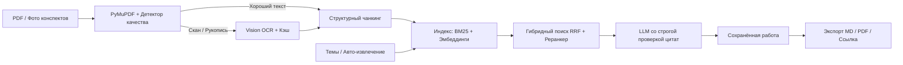

# ExamRAG


Локальный RAG-пайплайн для подготовки к коллоквиумам и экзаменам по математике: распознаёт рукописные конспекты, парсит PDF-учебники и сверяет определения, теоремы и доказательства с указанием источников.

> **Статус:** Этап 0.5 — каркас репозитория, настройки, линтеры, тесты конфигурации и CI. ML-пайплайн ещё не реализован.

## Что планируется

- Загрузка PDF-учебников и фото/сканов рукописных конспектов.
- Два режима работы: по списку тем коллоквиума и авто-извлечение определений/теорем.
- Структурный чанкинг без разрыва формул и доказательств, гибридный поиск (BM25 + локальные эмбеддинги) и реранкинг.
- Генерация разбора со строгой проверкой цитат и отметкой неразборчивых мест.
- Сохранение работ, удаление, шаринг по токен-ссылке и экспорт в Markdown / PDF.

## Архитектура (план)



## План разработки (Roadmap)

| Этап | Содержание | Статус |
|---|---|---|
| **0.5** | Каркас проекта, uv, `.gitignore`, pre-commit, CI, ADR | В работе |
| **1** | Парсинг PDF, детектор качества страниц, Vision-OCR с кэшем, оценка CER | Запланировано |
| **2** | Бейзлайн RAG (BM25 + `e5-small`), сбор мини-датасета, базовый Streamlit UI | Запланировано |
| **3** | Гибрид RRF, `bge-m3`, реранкер, parent–child чанкинг, авто-извлечение | Запланировано |
| **4** | Генерация со сверкой, валидация цитат и отказов, оценка галлюцинаций | Запланировано |
| **5** | Работы (SQLite + SQLAlchemy), CRUD, шаринг по ссылке, экспорт MD/PDF | Запланировано |

## Метрики

> Таблицы с замерами качества OCR (CER, валидность LaTeX), поиска (Recall@k, MRR, nDCG@10) и генерации (faithfulness, точность цитат) появятся начиная с Этапа 1–2.

## Быстрый старт

Требуется Python 3.12 и [uv](https://docs.astral.sh/uv/).

```powershell
# 1. Установить зависимости из lock-файла
uv sync --locked

# 2. Создать локальный .env из шаблона и вписать свой API-ключ
copy .env.example .env

# 3. Запустить проверки и тесты
uv run pytest -q
```

## Структура проекта

```text
ExamRAG/
├─ src/examrag/
│  ├─ config.py            # Настройки из .env (pydantic-settings)
│  ├─ ingest/              # Парсинг PDF, OCR, детектор качества
│  ├─ chunking/            # Структурный и базовый чанкинг
│  ├─ retrieval/           # Эмбеддинги, BM25, гибрид, реранкер
│  ├─ generation/          # LLMClient, промты, схемы, проверка цитат
│  ├─ works/               # БД, CRUD, шаринг, экспорт
│  └─ api/                 # FastAPI
├─ app/                    # Streamlit-интерфейс
├─ eval/                   # Датасеты разметки и скрипты замера метрик
├─ notebooks/              # EDA и анализ ошибок
├─ tests/                  # Модульные тесты
└─ docs/decisions/         # Архитектурные решения (ADR)
```

## Дисклеймер по данным

Учебники, сканы и личные конспекты **не хранятся в репозитории** (директория `data/` и файлы `*.pdf`, `*.png`, `*.jpg` добавлены в `.gitignore`). В репозитории допускаются только открытые материалы или собственные обезличенные примеры для оценки качества.

## Лицензия

Распространяется под лицензией MIT, см. [LICENSE](LICENSE).
